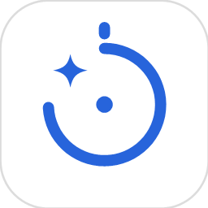

# 余刻 · QuotaClock

**简体中文** · [English](./README.en.md)



一个面向多种 AI 服务的 Windows 桌面额度看板，集中查看剩余额度、重置倒计时和本机 Token 用量。

**[下载 Windows 版](https://github.com/PhiloKlein/-QuotaClock/releases)** · **QQ 交流群 `1135481515`**

## 加入交流群

在 QQ 搜索群号 **1135481515**。欢迎交流使用体验、报告问题，或投票选下一个想接入的模型。

<details>
<summary>展开 QQ 入群二维码</summary>


</details>

## 快速开始

1. 从 Releases 的 **Assets** 下载 `QuotaClock.exe`，双击运行。
2. 打开「设置 → 数据源」，选择 Codex、Gemini 或 Claude，按对应入口配置。
3. 用「添加数据源」选配 DeepSeek 或连接兼容的 JSON 额度接口。Windows 托盘可以打开卡片外观、自启和通知设置。

## 数据源

- **OpenAI Codex** 通过已登录的 Codex CLI 读取账号额度。
- **Google Gemini** 通过 Antigravity 读取共享额度。Google AI Studio 项目的 API Key 可测试，并可打开官方用量页。
- **Anthropic Claude** 通过 Claude Code 状态栏读取订阅额度快照。状态栏要先连接，并在 Claude Code 产生额度数据后更新。
- **DeepSeek** 通过 API Key 查询账户余额，按 CNY 或 USD 显示。
- **其他服务** 可提供只读 GET JSON 地址。支持 HTTPS 或本机 HTTP，可选 Bearer Key。每张卡最多显示两个窗口。

自定义接口示例。每项也可用 `remaining` 和 `limit` 代替 `remaining_percent`，`resets_at` 接受 Unix 秒或 RFC 3339 时间。

```json
{"windows":[{"label":"每日","remaining_percent":72,"resets_at":"2026-12-01T08:00:00Z"}]}
```

[小红书](https://www.xiaohongshu.com/user/profile/5c0767606b58b7084fdc17f1) · [哔哩哔哩](https://space.bilibili.com/2552988) · [问题反馈](https://github.com/PhiloKlein/-QuotaClock/issues) · [第三方许可](./THIRD-PARTY-LICENSE.txt)
